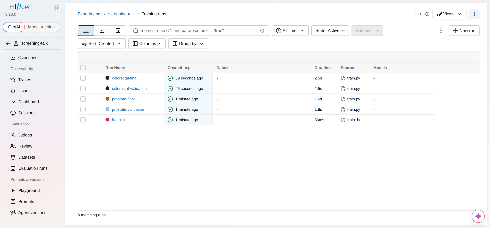
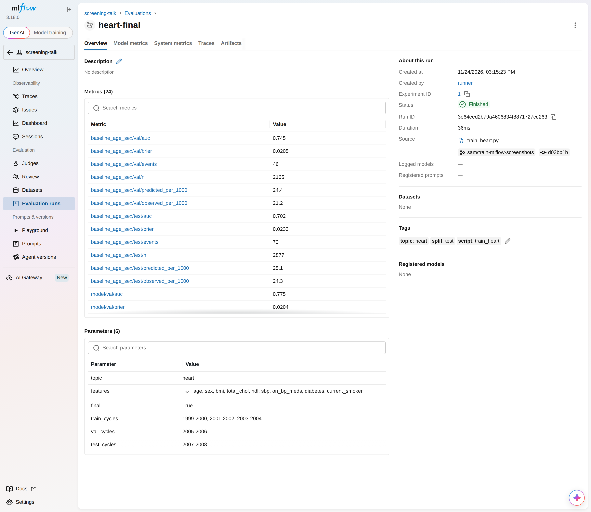

# Screening Talk

A patient decision aid for preventive care, built as a reproducible ML pipeline (AIPI 510, Module Project 3).
A person answers a few questions, picks an organ, and sees how a screening test or medicine could change their own
risk, next to what the clinical trials found. Topics: **heart disease and stroke** (statin, blood pressure medicine,
aspirin, checkups), **prostate cancer** (PSA test) and **colorectal cancer** (colonoscopy, stool test).

> Educational demo, not medical advice. Nothing entered in the app is stored.

| | |
|---|---|
| **Live app** | https://screening-talk.streamlit.app |
| **Live API** | https://screening-talk-api-ot2dnn2fka-ue.a.run.app ([`/health`](https://screening-talk-api-ot2dnn2fka-ue.a.run.app/health), [`/docs`](https://screening-talk-api-ot2dnn2fka-ue.a.run.app/docs)) |
| **Data** | `gs://screening-talk-2611-data` (Google Cloud Storage) |
| **Demo video** | [`docs/demo.mp4`](docs/demo.mp4) (85 s) |

## Contents
[Overview](#overview) · [Architecture](#architecture) · [Dataset](#dataset) · [Models and evaluation](#models-and-evaluation) ·
[Cloud services](#cloud-services) · [Setup](#setup) · [Train](#reproduce-the-data-and-train-the-models) ·
[API locally](#build-and-test-the-api-locally) · [Deploy](#deploy-to-the-cloud) · [Ethics and limitations](#ethics-and-limitations)

## Overview
Screening decisions are usually explained with population averages. This project turns them into a personal estimate:

1. A model trained on NHANES gives a person's **baseline risk** from their age, sex and health measures.
2. The **relative effect from published trials** (e.g. a statin lowers cardiovascular events by 28%) is applied to that baseline.
3. The app shows both numbers side by side, with every source linked.

Engineering goals: cloud-hosted versioned data, a config-driven pipeline, tracked experiments, one Docker image for
training and serving, a public API on Cloud Run and a front end that calls it.

## Architecture
```
CDC (NHANES + linked mortality)
   │  src/data/download.py   raw files + SHA-256 manifest, dated raw copy ──► GCS raw/<date>/
   ▼
src/data/clean.py           schema.yaml checks, cleaning rules, row counts ──► docs/cleaning/
   │  src/data/upload.py     clean parquet ──► GCS clean/<topic>/v1/   (hash recorded in topics/<topic>.yaml)
   ▼
src/train.py, train_heart.py   download from GCS, verify hash, split by survey cycle, train, evaluate ──► MLflow
   │
   ▼
Docker image (src/api, FastAPI) ──► Cloud Run  /predict ◄── Streamlit app (app/streamlit_app.py)
```
All settings live in [`config.yaml`](config.yaml) (seed, storage, tracking) and one file per topic in
[`topics/`](topics) (NHANES files, cleaning rules, target, features, split, model parameters).

## Dataset
- **Source:** [NHANES](https://wwwn.cdc.gov/nchs/nhanes/) (CDC National Health and Nutrition Examination Survey),
  1999–2018 public files, plus the [NCHS linked mortality files](https://www.cdc.gov/nchs/data-linkage/mortality-public.htm) (deaths through 2019).
- **Storage:** cleaned data in `gs://screening-talk-2611-data/clean/<topic>/v1/clean.parquet`, dated raw copies in
  `gs://screening-talk-2611-data/raw/2026-11-23/`. Each raw file's URL, size and SHA-256 are in
  [`data/raw/MANIFEST.json`](data/raw/MANIFEST.json).
- **Integrity:** training stops if the downloaded parquet's SHA-256 differs from `clean_sha256` in the topic file.
  Row counts after each cleaning rule are in [`docs/cleaning/`](docs/cleaning), and EDA is in [`docs/eda/`](docs/eda).
- **Trial evidence:** every trial number shown in the app comes from [`evidence/*.json`](evidence), with source URL,
  page or table reference, and who verified it against the paper.

| Topic | Population | Target (binary) | Train / validation / test cycles |
|---|---|---|---|
| Heart | Adults 40–75 without prior heart disease or stroke | Death from heart disease or stroke within 10 years | 1999–2004 / 2005–06 / 2007–08 |
| Prostate | Men 50–69 | PSA ≥ 4.0 ng/mL at the exam | 2001–06 / 2007–08 / 2009–10 |
| Colorectal | Adults 45–79 | Ever diagnosed with colon or rectal cancer | 1999–2010 / 2011–14 / 2015–18 |

## Models and evaluation
**Model:** a scikit-learn `Pipeline` with all preprocessing inside, so the API applies exactly the same transforms
as training. Age goes through a cubic spline, numeric features are imputed and scaled, categorical features are
imputed and one-hot encoded, and the classifier is a `LogisticRegression`. For prostate and colorectal, `C` is chosen
by validation Brier score; heart uses `C = 1`.

- **Features:** heart uses age, sex, BMI, total and HDL cholesterol, systolic BP, BP medication, diabetes and smoking.
  Prostate uses age, race/ethnicity and BMI. Colorectal uses age, sex, BMI, smoking and diabetes.
- **Evaluation:** data is split by survey cycle (later cycles for testing). Metrics are AUC with bootstrap 95% CI,
  Brier score, calibration and subgroup metrics by race/ethnicity. The baseline uses age only (age and sex for heart),
  and the test set is scored once (`--final`).

Final test-set results ([`docs/models/results.md`](docs/models/results.md)):

| Model | Test people | AUC (95% CI) | Baseline AUC | Brier (model / baseline) | Per 1,000: predicted / observed |
|---|---|---|---|---|---|
| Heart | 2,877 | 0.782 | 0.702 | 0.0234 / 0.0233 | 24.1 / 24.3 |
| Prostate | 864 | 0.663 (0.61–0.72) | 0.686 | 0.0663 / 0.0657 | 72.2 / 72.9 |
| Colorectal | 5,958 | 0.632 (0.57–0.69) | 0.633 | 0.0113 / 0.0113 | 9.1 / 11.4 |

- **Heart** discriminates clearly better than its age-and-sex baseline and is well calibrated. The app uses it as
  each person's 10-year baseline risk and applies each medicine's trial effect to it.
- **Prostate** is well calibrated, but age carries most of the signal. The app shows it as the chance of a raised
  PSA (not of cancer), alongside the ERSPC trial results.
- **Colorectal:** the NHANES target is lifetime history rather than a 10-year forecast, so the app's colonoscopy
  page uses US cancer-registry (SEER) rates by age and sex instead. The model is still served by the API.

### Experiment tracking (MLflow)
Every training run is an MLflow run. Each run logs:
- **Parameters:** features, chosen `C`, training cycles, data URI and SHA-256.
- **Metrics:** AUC with CI, Brier score, baseline metrics, and validation Brier for each `C`.
- **Artifacts:** model, model card, calibration chart, subgroup tables, run metadata (git commit, image, package
  versions, seed) and the log.

```bash
mlflow ui --backend-store-uri sqlite:///mlflow.db   # open http://127.0.0.1:5000
```
Set `MLFLOW_TRACKING_URI` to log to a remote MLflow server instead of the local `mlflow.db` / `mlruns/`.

The training workflow keeps `mlflow.db` and `mlruns/` as a downloadable artifact (Actions tab, latest
"train all models" run) and saves these screenshots of its MLflow UI:




## Cloud services
| Service | Use |
|---|---|
| Google Cloud Storage | Raw snapshots and versioned clean data |
| Artifact Registry | Docker image |
| Cloud Run | Public FastAPI service (`us-east1`, scales to zero) |
| GitHub Actions | CI tests on every PR; training and deployment workflows; Workload Identity Federation (no key files) |
| Streamlit Community Cloud | Public front end |

## Repository structure
```
src/data/        download, clean, upload, ingest (cloud data with hash check)
src/             features.py, train.py, train_heart.py, evaluate.py, tracking.py (MLflow)
src/api/         FastAPI app: /health, /topics, /predict
app/             Streamlit front end
topics/          one config per topic        config.yaml, schema.yaml   pipeline settings and data checks
evidence/        verified trial numbers      models/                    trained models baked into the image
scripts/         gcp_setup.sh, smoke_test.py tests/                     pytest suite (runs in CI)
docs/            cleaning logs, EDA, model reports, proposal, demo
```

## Setup
Python 3.11.
```bash
git clone https://github.com/samuelmteshome/screening-talk-510-project-3 && cd screening-talk-510-project-3
python3.11 -m venv .venv && source .venv/bin/activate
pip install -r requirements.txt
cp .env.example .env        # set GCS_BUCKET; never commit .env
pytest -q                   # full test suite
```
For the cloud bucket, authenticate once with `gcloud auth application-default login`.

## Reproduce the data and train the models
```bash
make data TOPIC=heart                         # download → clean → upload (same for prostate, colorectal)
python -m src.train_heart --final             # heart model
python -m src.train --topic prostate          # validation run: selects C
python -m src.train --topic prostate --final  # refit on train + validation, score the test cycles once
python -m src.train --topic colorectal --final
```
Without cloud access, train on the local file: `--data-uri data/clean/<topic>/clean.parquet --allow-unverified --no-upload`.
Each run writes `runs/<run_id>/` (model, model card, metrics, calibration chart, metadata, log) and logs it to MLflow.
The **train all models** workflow in GitHub Actions runs all three from scratch.

## Build and test the API locally
One image serves the API and can also train (`docker run screening-talk train --topic prostate`).
```bash
docker build -t screening-talk .
docker run -p 8080:8080 screening-talk
curl -s localhost:8080/health
curl -s -X POST localhost:8080/predict -H 'Content-Type: application/json' -d @tests/example_request.json
python scripts/smoke_test.py http://localhost:8080   # /health, /topics and one /predict per topic
```
`POST /predict` returns the person's risk plus the trial evidence for that topic (full schema at `/docs`).
People outside the ages the data covers get no number and a reason.

## Deploy to the cloud
1. **One-time Google Cloud setup:** in Cloud Shell, run `scripts/gcp_setup.sh`. It creates the bucket, the Artifact
   Registry repo and the service accounts (GitHub deploys through Workload Identity Federation), then prints six
   values to add as GitHub repository variables (`GCP_PROJECT_ID`, `GCP_REGION`, `GCP_WIF_PROVIDER`,
   `GCP_DEPLOY_SA`, `GCP_RUNTIME_SA`, `GCS_BUCKET`).
2. **API:** Actions → **deploy API to Cloud Run** → Run workflow. It trains the models, builds and pushes the image,
   deploys `screening-talk-api` and smoke-tests the live URL.
3. **Front end:** in Streamlit Community Cloud, create an app from this repo with main file `app/streamlit_app.py`,
   and add the secret `API_URL = "https://screening-talk-api-ot2dnn2fka-ue.a.run.app"`.

Check the live endpoint:
```bash
curl -s -X POST https://screening-talk-api-ot2dnn2fka-ue.a.run.app/predict -H 'Content-Type: application/json' \
  -d '{"topic":"heart","age_years":60,"sex":"female","bmi_kg_m2":28,"total_chol":210,"hdl":50,"sbp":140,"on_bp_meds":false,"diabetes":false,"current_smoker":true}'
# → probability 0.0242: about 24 in 1,000 die of heart disease or stroke in 10 years
```

## Ethics and limitations
- **Not medical advice.** The app frames every result as a starting point for a conversation with a doctor and
  stores nothing; answers live only in the page address.
- **Averages applied to individuals.** Trial effects come from trial participants and are applied to one person's
  baseline risk. Each page names both sources.
- **Data limits:**
  - NHANES records deaths, not heart attacks or strokes. That risk comes from the AHA PREVENT equations.
  - Prostate and colorectal targets are cross-sectional; only heart follows people forward in time.
- **Uncertainty and fairness:**
  - Test sets have few events (70 heart deaths, 63 raised PSAs, 68 colorectal cancers), so AUCs are uncertain.
  - The shared trainer logs metrics by race/ethnicity for every run, because small subgroups can be poorly served.
- **Scope:** people outside the ages the data covers get no personal number.

## Team
- **Alberto Gómez Soteres** ([@albertogomezsoteres](https://github.com/albertogomezsoteres)): data pipeline and cloud
  storage, data versioning, shared trainer and evaluation, prostate model, MLflow tracking, evidence verification.
- **Sam** ([@samuelmteshome](https://github.com/samuelmteshome)): heart model, FastAPI service and Docker, CI and
  Cloud Run deployment, Streamlit front end.

Project proposal: [`docs/proposal.md`](docs/proposal.md)
