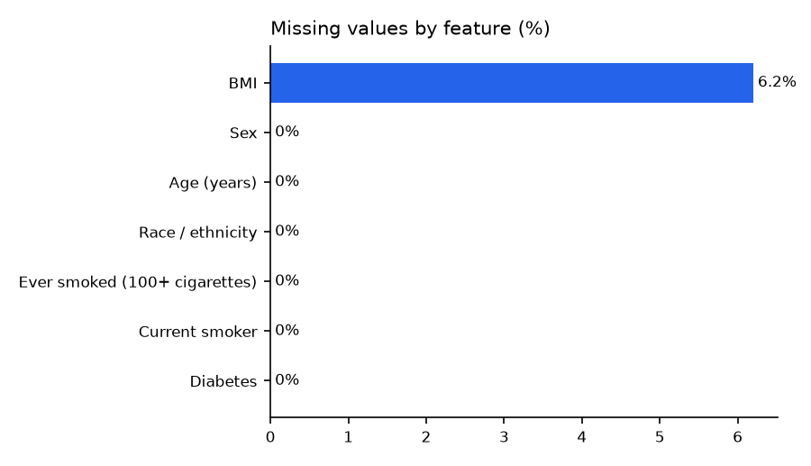
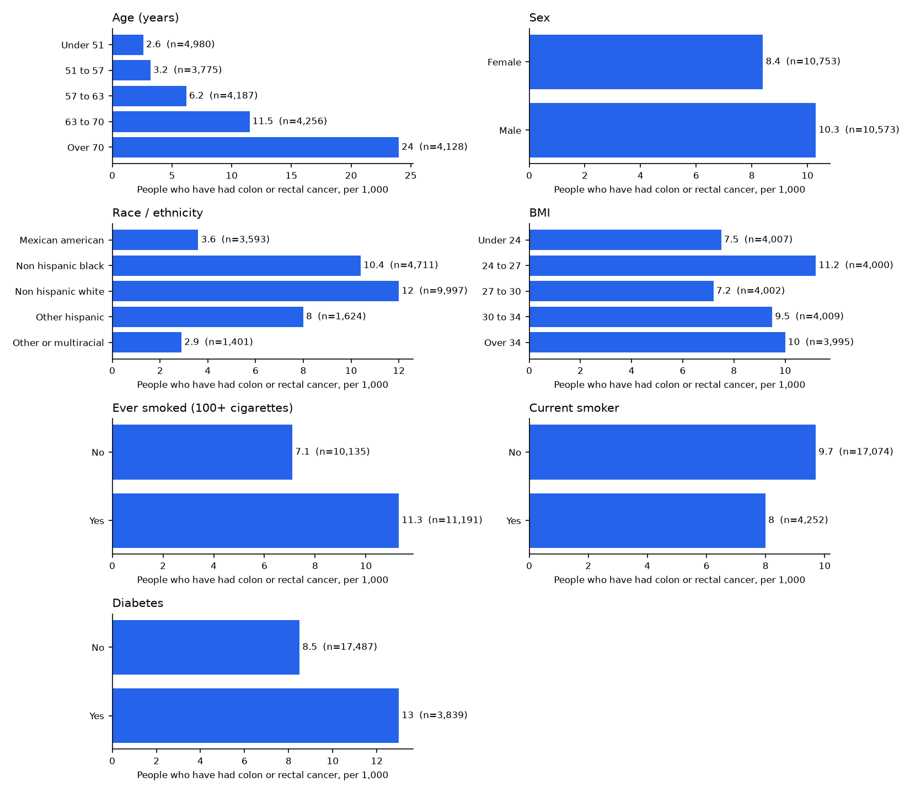

# EDA: colorectal

Training and validation cycles only (1999-2000, 2001-2002, 2003-2004, 2005-2006, 2007-2008, 2009-2010, 2011-2012, 2013-2014); test cycles (2015-2016, 2017-2018) are not looked at.

## Outcome

- People: **21,326**
- Ever told they had colon or rectal cancer: **199** (9.3 per 1,000)

| Cycle | People | Events | Per 1,000 |
| --- | --- | --- | --- |
| 1999-2000 | 2,345 | 21 | 9 |
| 2001-2002 | 2,458 | 31 | 12.6 |
| 2003-2004 | 2,358 | 23 | 9.8 |
| 2005-2006 | 2,223 | 14 | 6.3 |
| 2007-2008 | 3,110 | 33 | 10.6 |
| 2009-2010 | 3,144 | 32 | 10.2 |
| 2011-2012 | 2,774 | 26 | 9.4 |
| 2013-2014 | 2,914 | 19 | 6.5 |

## Missing values

People with every candidate feature present: **20,013** of 21,326 (94%).

## Feature summary

| Feature | Values |
| --- | --- |
| Age (years) | median 61 (IQR 52 to 68) |
| Sex | female 50%, male 50% |
| Race / ethnicity | non_hispanic_white 47%, non_hispanic_black 22%, mexican_american 17%, other_hispanic 8%, other_or_multiracial 7% |
| BMI | median 28.41 (IQR 24.97 to 32.63) |
| Ever smoked (100+ cigarettes) | 52.5% yes |
| Current smoker | 19.9% yes |
| Diabetes | 18.0% yes |

## Event rate by feature

Continuous features are split into five equal-sized groups.

## How much each feature tells us

AUC alone: 0.5 is a coin flip, 1.0 is perfect. Odds ratio is after accounting for age (per standard deviation for numbers, yes vs no for yes/no features).

| feature | n | AUC alone | Age-adjusted odds ratio | per |
| --- | --- | --- | --- | --- |
| Age (years) | 21326 | 0.729 |  |  |
| Sex | 21326 | 0.526 | 1.21 | men vs women |
| Race / ethnicity | 21326 | 0.594 |  |  |
| BMI | 20013 | 0.514 | 1.1 | 1 SD |
| Ever smoked (100+ cigarettes) | 21326 | 0.557 | 1.55 | yes vs no |
| Current smoker | 21326 | 0.514 | 1.22 | yes vs no |
| Diabetes | 21326 | 0.536 | 1.24 | yes vs no |

## Correlation between numeric features

| index | age | bmi |
| --- | --- | --- |
| Age (years) | 1.0 | -0.04 |
| BMI | -0.04 | 1.0 |
