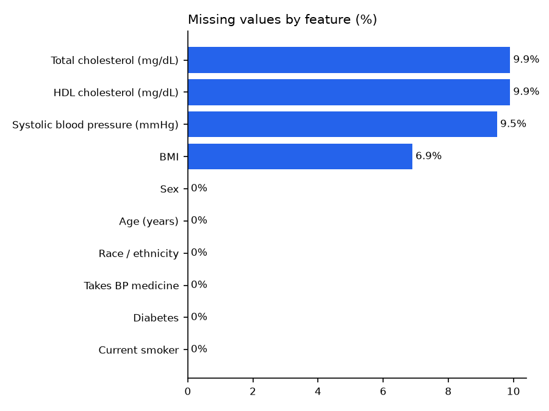
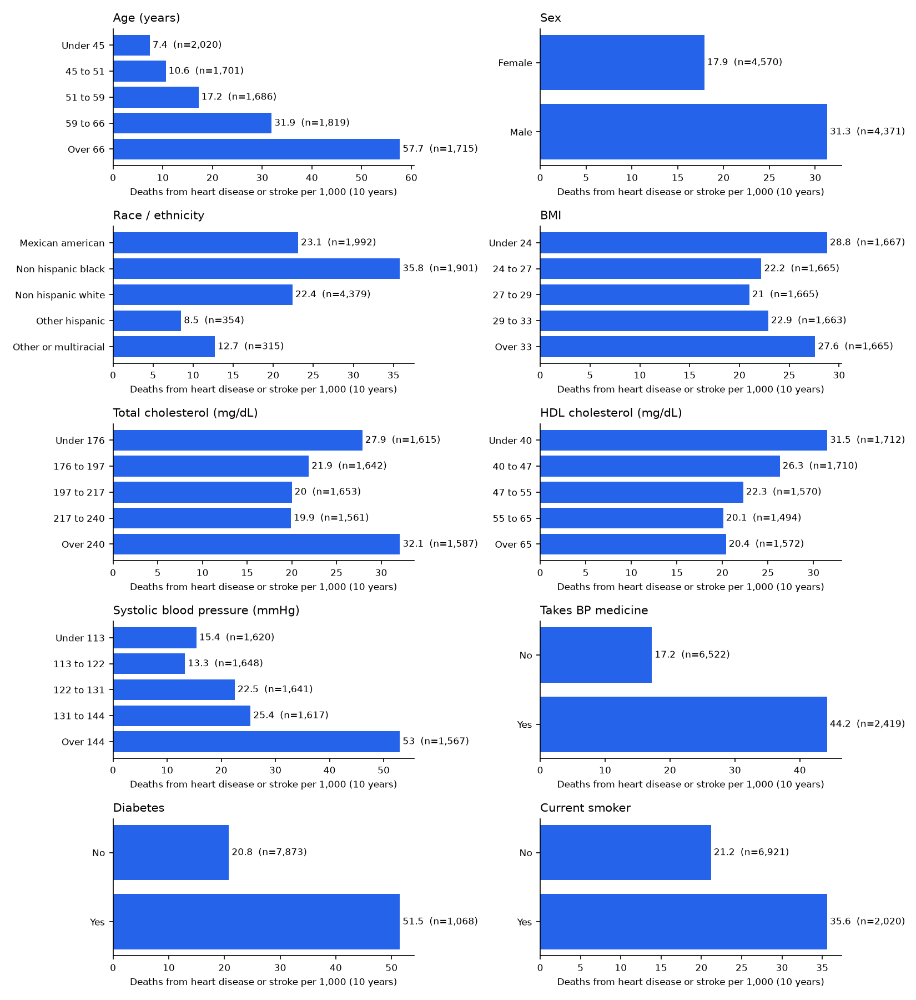

# EDA: heart

Training and validation cycles only (1999-2000, 2001-2002, 2003-2004, 2005-2006); test cycles (2007-2008) are not looked at.

## Outcome

- People: **8,941**
- Died of heart disease or stroke within 10 years: **219** (24.5 per 1,000)
- Died of any cause within 10 years: 939 (deaths from other causes count as no event)

| Cycle | People | Events | Per 1,000 |
| --- | --- | --- | --- |
| 1999-2000 | 2,204.0 | 67.0 | 30.4 |
| 2001-2002 | 2,403.0 | 54.0 | 22.5 |
| 2003-2004 | 2,169.0 | 52.0 | 24 |
| 2005-2006 | 2,165.0 | 46.0 | 21.2 |

## Missing values

People with every candidate feature present: **7,610** of 8,941 (85%).

## Feature summary

| Feature | Values |
| --- | --- |
| Age (years) | median 54 (IQR 46 to 64) |
| Sex | female 51%, male 49% |
| Race / ethnicity | non_hispanic_white 49%, mexican_american 22%, non_hispanic_black 21%, other_hispanic 4%, other_or_multiracial 4% |
| BMI | median 28.08 (IQR 24.74 to 32.11) |
| Total cholesterol (mg/dL) | median 207 (IQR 182 to 233) |
| HDL cholesterol (mg/dL) | median 51 (IQR 42 to 62) |
| Systolic blood pressure (mmHg) | median 126.667 (IQR 115.333 to 140) |
| Takes BP medicine | 27.1% yes |
| Diabetes | 11.9% yes |
| Current smoker | 22.6% yes |

## Event rate by feature

Continuous features are split into five equal-sized groups.

## How much each feature tells us

AUC alone: 0.5 is a coin flip, 1.0 is perfect. Odds ratio is after accounting for age (per standard deviation for numbers, yes vs no for yes/no features).

| feature | n | AUC alone | Age-adjusted odds ratio | per |
| --- | --- | --- | --- | --- |
| Age (years) | 8941 | 0.712 |  |  |
| Sex | 8941 | 0.57 | 1.81 | men vs women |
| Race / ethnicity | 8941 | 0.565 |  |  |
| BMI | 8325 | 0.494 | 1.06 | 1 SD |
| Total cholesterol (mg/dL) | 8058 | 0.508 | 1.02 | 1 SD |
| HDL cholesterol (mg/dL) | 8058 | 0.552 | 0.81 | 1 SD |
| Systolic blood pressure (mmHg) | 8093 | 0.642 | 1.38 | 1 SD |
| Takes BP medicine | 8941 | 0.612 | 1.77 | yes vs no |
| Diabetes | 8941 | 0.567 | 1.95 | yes vs no |
| Current smoker | 8941 | 0.553 | 2.38 | yes vs no |

## Correlation between numeric features

| index | age | bmi | total_chol | hdl | sbp |
| --- | --- | --- | --- | --- | --- |
| Age (years) | 1.0 | -0.03 | 0.06 | 0.07 | 0.36 |
| BMI | -0.03 | 1.0 | -0.02 | -0.25 | 0.12 |
| Total cholesterol (mg/dL) | 0.06 | -0.02 | 1.0 | 0.11 | 0.08 |
| HDL cholesterol (mg/dL) | 0.07 | -0.25 | 0.11 | 1.0 | 0.01 |
| Systolic blood pressure (mmHg) | 0.36 | 0.12 | 0.08 | 0.01 | 1.0 |
