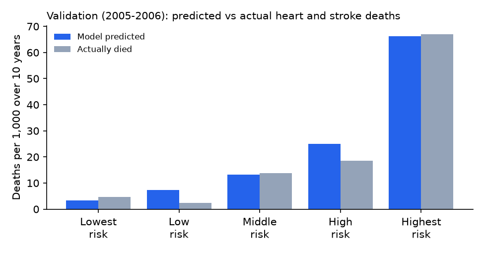

# Heart model

Logistic regression on age, sex, bmi, total_chol, hdl, sbp, on_bp_meds, diabetes, current_smoker. Target: death from heart disease or stroke within 10 years of the NHANES exam (linked death records).

Trained on 1999-2000, 2001-2002, 2003-2004 (6,776 people, 173 deaths).

| Model | Split | People | Deaths | AUC | Brier | Predicted per 1,000 | Observed per 1,000 |
| --- | --- | --- | --- | --- | --- | --- | --- |
| baseline_age_sex | val | 2,165 | 46 | 0.745 | 0.0205 | 24.4 | 21.2 |
| baseline_age_sex | test | 2,877 | 70 | 0.702 | 0.0233 | 25.1 | 24.3 |
| model | val | 2,165 | 46 | 0.775 | 0.0204 | 23.0 | 21.2 |
| model | test | 2,877 | 70 | 0.782 | 0.0234 | 24.1 | 24.3 |

## Odds ratios (per SD for numbers, yes vs no for yes/no answers)

| Term | Odds ratio |
| --- | --- |
| age | 1.86 |
| bmi | 1.01 |
| total_chol | 1.13 |
| hdl | 0.93 |
| sbp | 1.43 |
| missingindicator_bmi | 1.17 |
| missingindicator_total_chol | 1.05 |
| missingindicator_hdl | 1.05 |
| missingindicator_sbp | 0.7 |
| on_bp_meds | 1.6 |
| diabetes | 1.98 |
| current_smoker | 2.05 |
| sex_male | 2.06 |
